# Hunter

Hunter watches company job boards for new postings and sends each new match to your phone on Telegram, usually within minutes of it going up. Everything else happens on a private dashboard:

- browse jobs
- track your applications
- tailor your resume with Claude

It runs free on GitHub Actions and GitHub Pages. You don't need a server.

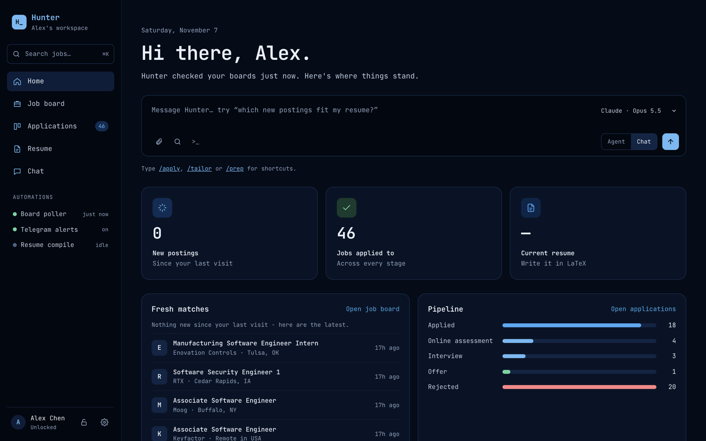

<sub>Screenshots use demo data.</sub>

## Contents

- [What it does](#what-it-does)
- [The dashboard](#the-dashboard)
- [Setup](#setup)
- [Privacy](#privacy)
- [Running locally](#running-locally)

## What it does

- **Watches job boards.** It polls your watchlist every few minutes: company boards on Greenhouse, Ashby, Lever, Workday and about a dozen more, plus curated GitHub job lists such as SimplifyJobs.
- **Sends only new jobs.** A job is sent once, and only if it passes your filters (level, keywords, region).
- **Finds new company boards on its own.** When a company keeps appearing late through the GitHub lists, Hunter starts polling that company's board directly.
- **Sends a weekly summary in Telegram:** jobs sent, your marks and applications, and suggested boards to add.
- **Publishes a dashboard.** It's a single page on GitHub Pages, and anything personal on it is encrypted.

```
sources.yaml → fetch → normalize → dedup → filter → Telegram
                                     ↑
                              seen_jobs.json (committed state)
```

## The dashboard

The dashboard is published at `https://<you>.github.io/<repo>/`. Anyone can see the public job listings. Your applications, marks and settings show up only after you unlock with your passphrase.

### Job board

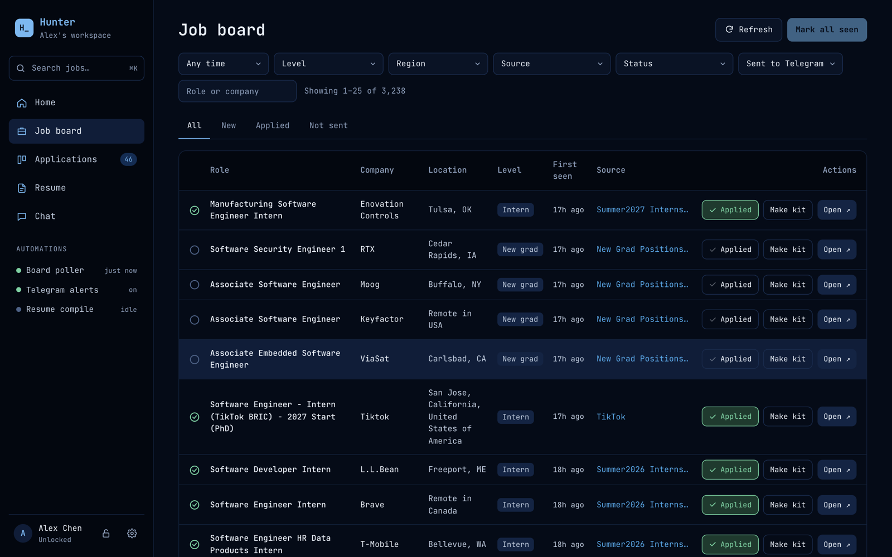

- **Contents:** every job sent to you in the last 90 days, plus open postings that pass your filters.
- **Filters:** date, level, region, source and status. The tabs are **All**, **New**, **Applied** and **Not sent**.
- **New:** jobs that arrived since your last visit show a blue dot. Opening a job clears its dot.
- **Row buttons:**
  - **Applied** puts the job on your application board.
  - **Make kit** tailors your resume to the job.
  - **Open ↗** goes to the posting.

### Applications

Your applications move through **Applied → Online assessment → Interview → Offer / Rejected**. You can see them as a board or as a list.

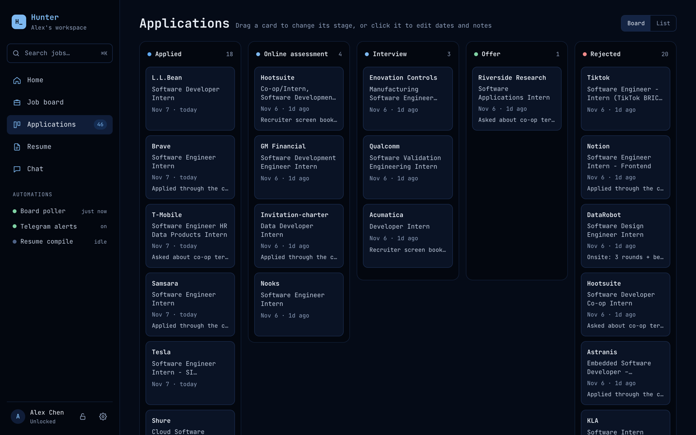

- **Moving a job:** drag its card to another column. You can also click a card to change its stage, edit the stage dates, or add notes.
- **Long columns:** each column shows its 8 newest cards. Press **Load more…** to see the rest.

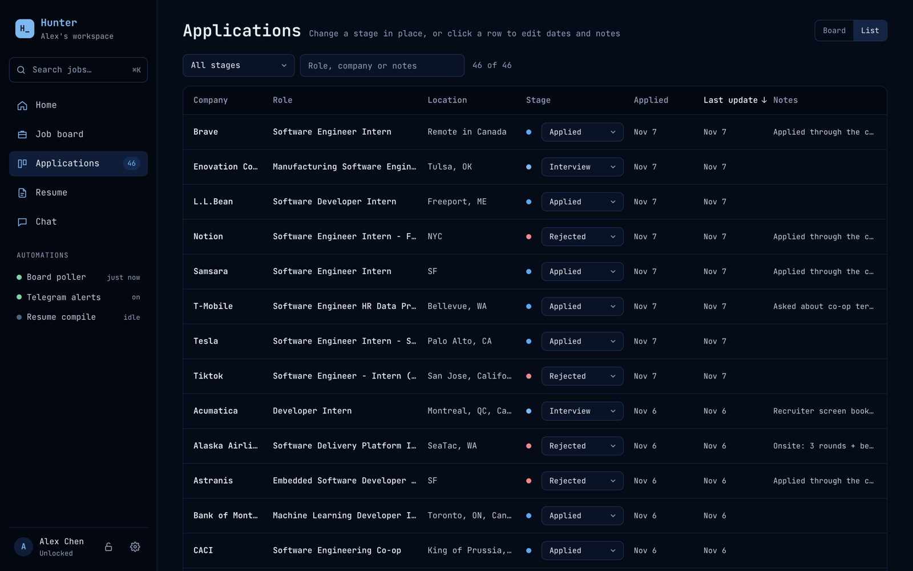

- **The list:** switch with **Board / List** at the top right. The list works like a spreadsheet:
  - Sort by any column.
  - Filter by stage, or search, including your notes.
  - Change a stage straight from its dropdown.
- **Same on every device:** changes sync, so after you unlock you see the same board everywhere (see [GitHub token](#github-token-sync)).

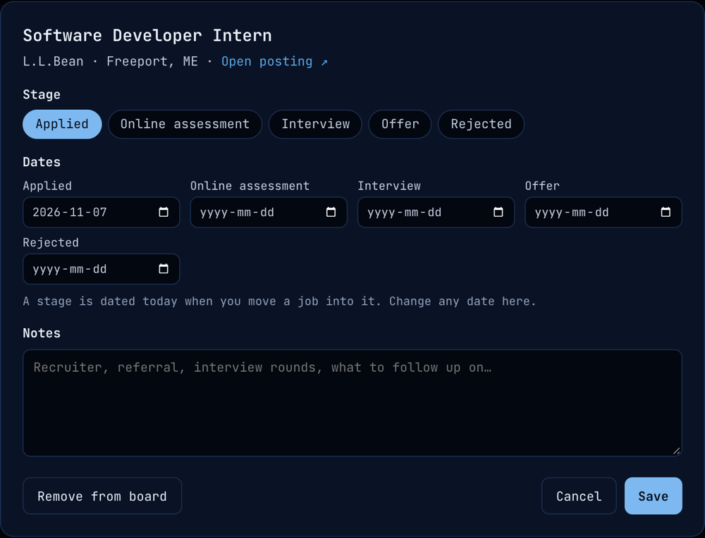

### Make kit

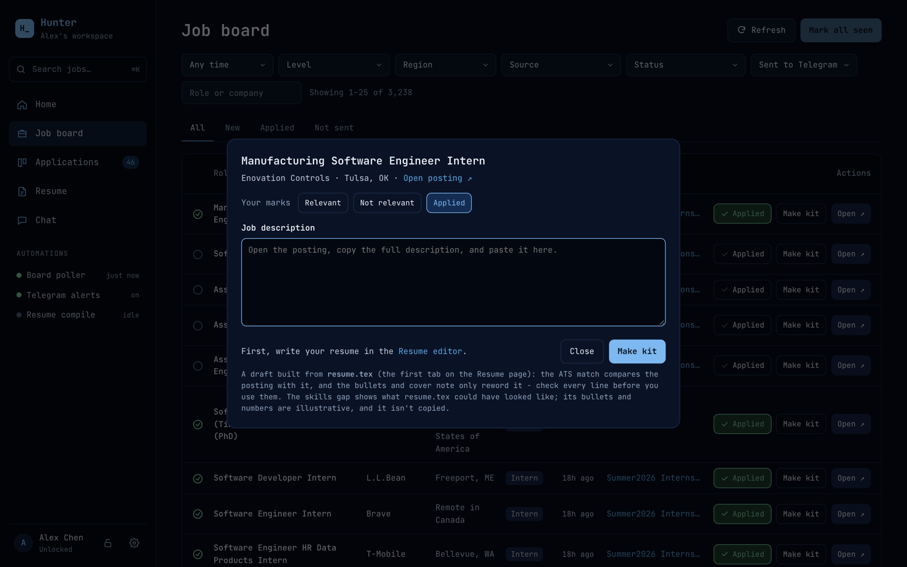

Paste a job description and Claude returns:

- **ATS match:** how well your resume covers the posting's requirements.
- **Tailored bullets and a short cover note:** reworded from your resume only.
- **Skills gap:** what's missing, for reference.

The kit also has **Relevant / Not relevant** buttons. Those marks are saved as training data for a future relevance model.

Make kit needs a [Claude API key](#claude-api-key). Each kit costs a few cents.

### Resume

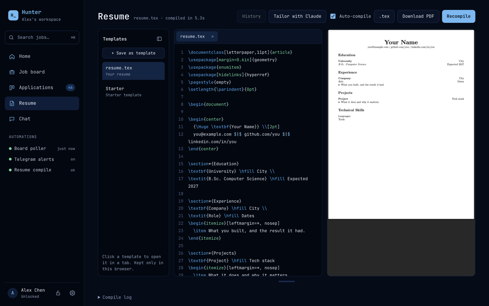

- **An Overleaf-style LaTeX editor** with a live PDF preview. It compiles in your browser (WebAssembly pdfLaTeX), so your resume never leaves the page.
- **resume.tex** is the resume that Make kit and Chat use.
- **Templates:** save them and open them in tabs, like an IDE.
- **Stays in one browser:** everything here is kept only in this browser.

### Chat

You can talk to Claude about your job board and resume using your own API key. Pick Opus, Sonnet or Haiku. Jobs Claude recommends appear as cards with **Make kit** and **Open**. Typing `/apply`, `/tailor` or `/prep` fills in a ready-made prompt for common requests.

### Telegram alerts

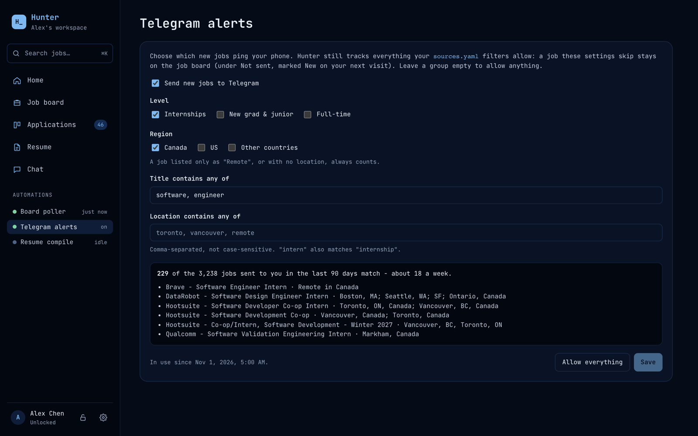

- **Choose which new jobs ping your phone** by level, region and keywords in the title or location.
- **Preview before saving:** a live count shows how many recent jobs would have matched.
- **Alerts only filter notifications.** Jobs they skip are still on the job board, under **Not sent**.

### Sources

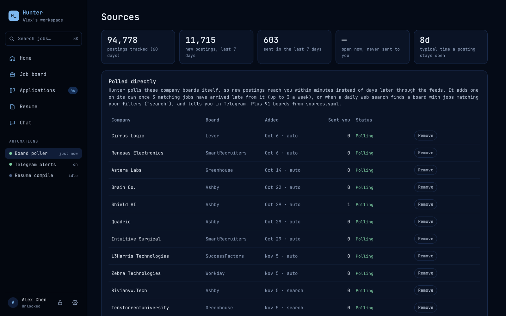

This page lists the company boards Hunter added by itself, with how many jobs each one sent you. From here you can **Remove** a board, **Resume** a paused one, or **Add** a suggested one.

<details>
<summary>How Hunter picks boards to add</summary>

- **When:** a company board has fed you 3 matching jobs late through the GitHub lists, and a live fetch of the board works.
- **Limits:** at most 3 new boards a week and 25 in total. Telegram tells you each time.
- **No flood:** a new board's existing jobs are recorded silently.
- **Failing boards:** a board that fails 5 runs in a row is paused.
- **Optional web search:** set `TAVILY_API_KEY` and Hunter also searches the web daily for boards with matching jobs, adding up to 5 a week. Edit the searches under `search_discovery:` in `sources.yaml`.

</details>

## Setup

### 1. Get the code

Fork or clone this repo into your own GitHub account. Then enable Actions on the **Actions** tab.

### 2. Create a Telegram bot

1. In Telegram, message [@BotFather](https://t.me/BotFather) and send `/newbot`.
2. Pick a name and a username ending in `bot`.
3. BotFather replies with a token like `123456789:AAE…xyz`. This is your **`TELEGRAM_BOT_TOKEN`**. Keep it secret.
4. Send any message (e.g. `hi`) to your new bot.
5. Open `https://api.telegram.org/bot<TOKEN>/getUpdates` in a browser and find `"chat":{"id":…}`. That number is your **`TELEGRAM_CHAT_ID`**. A group chat's ID is negative.

> Don't set a webhook on the bot. Hunter reads updates with `getUpdates`, which Telegram blocks while a webhook exists.

### 3. Add repo secrets

Go to **Settings → Secrets and variables → Actions → New repository secret**.

| Secret | Required | What it is |
| --- | --- | --- |
| `TELEGRAM_BOT_TOKEN` | yes | Token from BotFather |
| `TELEGRAM_CHAT_ID` | yes | Chat ID from `getUpdates` |
| `HUNTER_PASSPHRASE` | for the private dashboard | Your dashboard passphrase. Use 4+ random words; the encrypted data is public, so a weak one can be cracked offline. |
| `TAVILY_API_KEY` | no | Turns on web-search discovery. The free [Tavily](https://app.tavily.com) plan is enough. |

Never put secrets in `sources.yaml` or any other committed file.

- **No `HUNTER_PASSPHRASE`:** the dashboard is published with no private layer. There is no plaintext fallback.
- **Forgot it?** Set a new one. The next build uses it, and nothing is lost.

### 4. Turn on GitHub Pages

Go to **Settings → Pages → Build and deployment → Source: GitHub Actions**. The dashboard republishes every hour, and within minutes of a change you make on it.

### 5. Edit `sources.yaml`

```yaml
sources:            # boards to watch - one entry per company
  - type: ashby
    company: wealthsimple

profile:
  name: "Your Name" # the dashboard greets you with this once unlocked

filters:            # what counts as a match
  include_keywords: [engineer, developer, software, intern]
  exclude_keywords: [senior, staff, principal, manager]
```

The comments at the top of `sources.yaml` list the API URL to check for each board type before adding a company.

### 6. Set up the dashboard in your browser

Open your dashboard and press the lock (bottom left) to unlock it with `HUNTER_PASSPHRASE`. Tick **Remember on this device** to skip this next time.

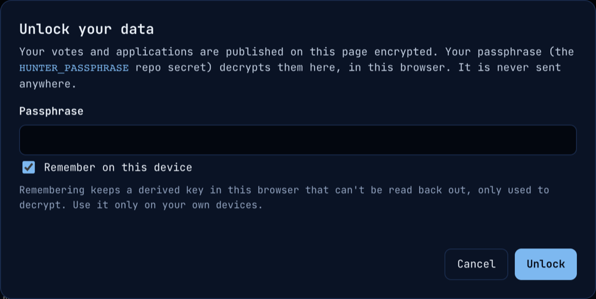

Then add your keys under **⚙ Settings** (bottom left). Each browser stores its own copy, and neither key is ever published or committed.

#### Claude API key

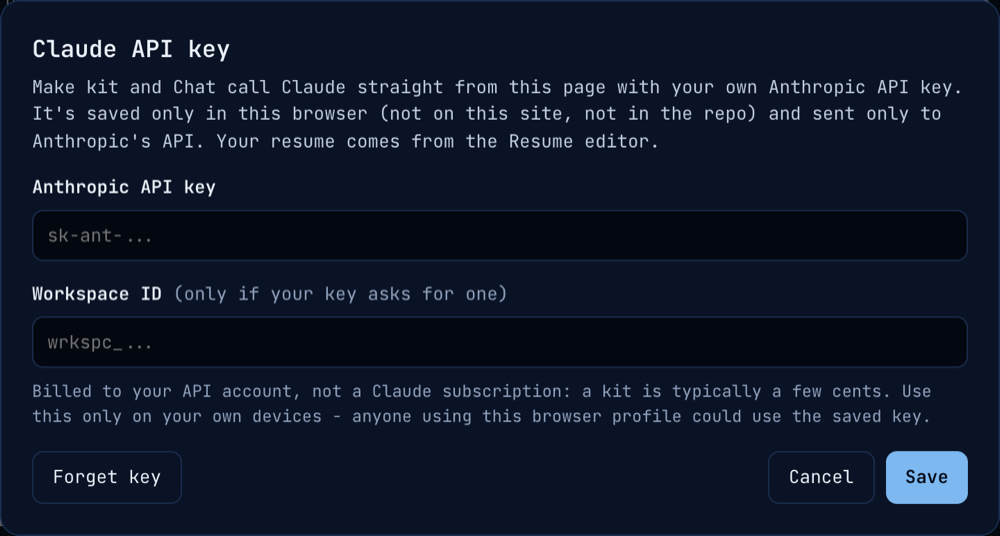

Make kit and Chat need this key.

1. Create a key at [console.anthropic.com](https://console.anthropic.com) → **API keys**. It starts with `sk-ant-`.
2. Paste it under **⚙ → Claude API key**.

Usage is billed to your API account; a Claude subscription doesn't cover it.

#### GitHub token (sync)

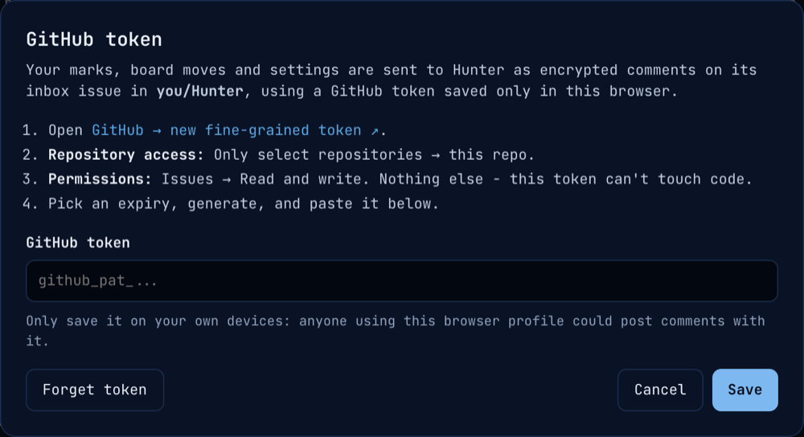

This token lets your Applied marks, board moves and settings reach Hunter.

1. Create a [fine-grained token](https://github.com/settings/personal-access-tokens/new).
2. Under **Repository access**, choose only this repo.
3. Under **Permissions**, set only **Issues → Read and write**. The token can't touch your code.
4. Paste it under **⚙ → GitHub token (sync)**.

Each change is sent as an encrypted comment on a locked "Hunter inbox" issue, which Hunter creates on its first run. That comment starts a run, and the change shows up on every device a few minutes later.

- **Not sent yet:** a card with a dashed outline hasn't been sent. It is kept in your browser and retried.
- **No token in this browser:** changes queue there until you add one. You only need a token on browsers you make changes from.

### 7. Optional: poll more reliably

GitHub's built-in schedule often runs late. For steady polling, trigger the workflow from an external cron service such as [cron-job.org](https://cron-job.org), every 5–10 minutes:

- **Request:** `POST https://api.github.com/repos/<you>/<repo>/actions/workflows/poll.yml/dispatches`
- **Headers:** `Authorization: Bearer <token>` and `Accept: application/vnd.github+json`
- **Body:** `{"ref":"main"}`
- **Token:** a fine-grained token for this repo with **Actions → Read and write**. Don't reuse the Issues token above.

If the service reports a `422`, check that the body names a branch that exists.

## Privacy

The repo and the dashboard are public, so:

- **Encrypted:** your applications, marks, alert settings and name reach the page only encrypted with AES-GCM, using a key derived from your passphrase. The page decrypts them in your browser, and the passphrase is never stored or sent.
- **Browser only:** your resume, templates and API key stay in your browser. They are sent only to Anthropic's API, when you use Make kit or Chat.
- **Caveat:** `seen_jobs.json`, the state file committed to the repo, still holds your votes and applications in plaintext. Encryption protects the dashboard, not the repo.

## Running locally

```bash
pip install -r requirements.txt
python -m scraper.main --dry-run   # full run, prints messages instead of sending
python -m scraper.dashboard        # build the dashboard into site/index.html
ruff check .                       # lint
pytest                             # tests run fully offline
```

`CLAUDE.md` covers the code layout, how to add a new board type, and the rules a change must not break.
